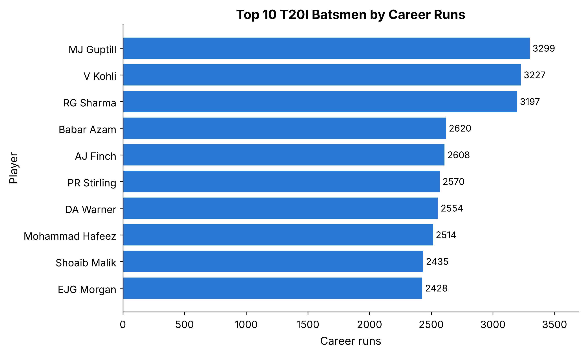
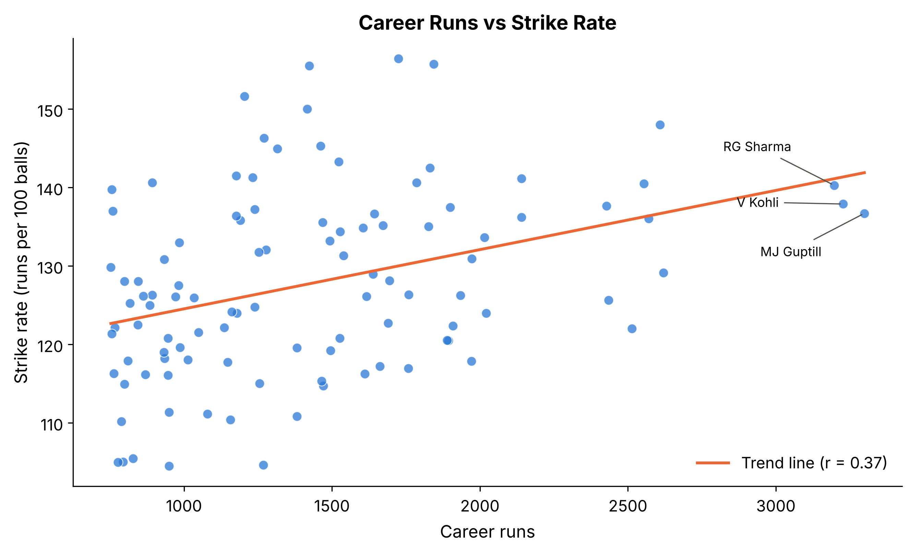

# Cricket Data Analysis and Visualization (T20I Batting)

Mini project (Assignment 12) – data cleaning with **Pandas**, numerical analysis with **NumPy**, and visualization with **Matplotlib/Seaborn** on T20 International batting career statistics (105 players, 15 columns).

**Author:** Nikhil Patil · Roll No. 43 · Division SEB · NMIET

## Run
```bash
pip install -r requirements.txt
python assignment12_t20_analysis.py
```
The script reads `data/twb.csv` and regenerates the cleaned CSV, statistics, correlation matrix and the 5 graphs. A notebook version is in `Assignment12_Cricket_Analysis.ipynb`.

## What's inside
| File | Purpose |
|---|---|
| `assignment12_t20_analysis.py` | Full workflow: load → inspect → clean → analyse → plot |
| `Assignment12_Cricket_Analysis.ipynb` | Same workflow as notebook cells |
| `Assignment12_Cricket_Analysis_Report.pdf` / `.docx` | 3-page report |
| `data/twb.csv` | Source data |
| `cleaned_cricket_dataset.csv` | Cleaned data (25 columns incl. helper columns) |
| `numerical_analysis_summary.csv`, `correlation_matrix.csv`, `data_quality_checks.csv` | Analysis outputs |
| `graphs/` | 5 PNG charts |

## Cleaning summary
The supplied file was already a lightly cleaned export. The checks found 0 missing values, 0 duplicates and 0 inconsistent figures, so nothing was imputed or corrected. Columns `100, 50, 0, 4s, 6s` were renamed (Hundreds, Fifties, Ducks, Fours, Sixes) and helper columns were added (Name, HS_Score, HS_NotOut, Boundary_Runs, Boundary_Pct, etc.). The `*` in highest score is preserved.

## Key results
- Most runs: MJ Guptill (3,299); best strike rate: C Munro (156.44); best average: V Kohli (52.04).
- Correlation: Runs–Fours r = 0.92, Runs–Matches r = 0.78, Runs–Strike rate r = 0.37 (association, not causation).




## Data source
Cricket statistics dataset (T20I batting file `twb.csv`) downloaded from Kaggle. Add the dataset title/URL here: _TODO_.
